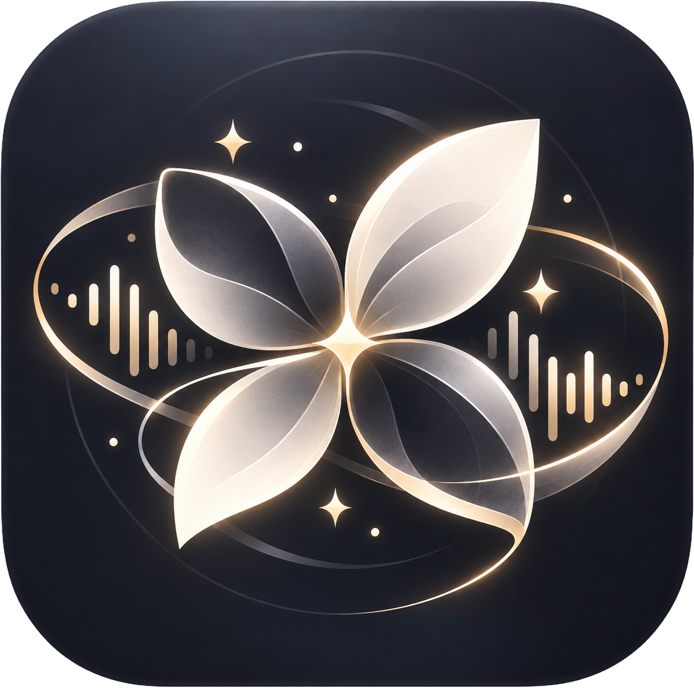
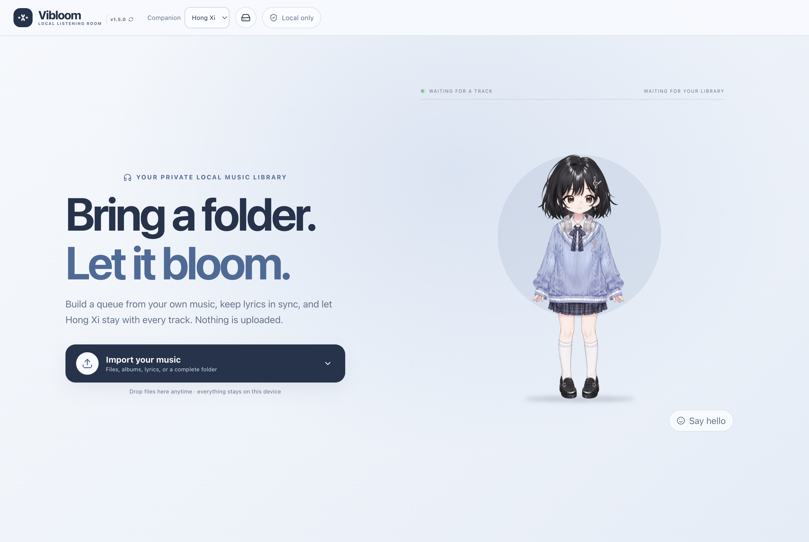
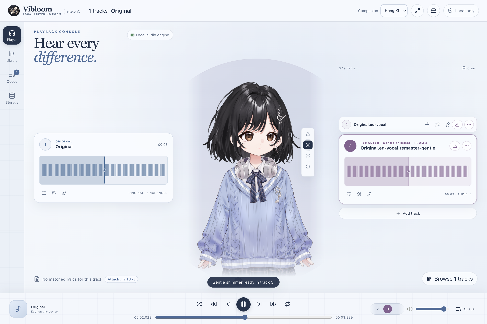

#  Vibloom

Your music library, brought to life.

A private music player for desktop and mobile browsers, macOS, and Windows. Listen, compare mixes, improve audio, and bring songs to life with lyrics and Live2D companions. No account, uploads, or analytics; your music stays on your device.

[Open the web player](https://wedoso.github.io/Vibloom/) · [Download the desktop app](https://github.com/wedoso/Vibloom/releases/latest)



## Features

- **Local library:** import music and matching LRC/TXT lyrics, organize albums with covers, search, manage the queue, and resume playback. Storage controls manage cached audio and reconnect missing files.
- **Synchronized comparison:** switch between the original and alternate versions at the same playback position. Desktop uses waveform cards with up to nine tracks; mobile offers a compact A/B view.
- **Audio processing on desktop:** preview EQ and mastering, apply Audio Repair presets, chain treatments into comparison tracks, and export WAV files. Desktop web and Electron share the processing implementation.
- **Lyrics:** follow synchronized lyrics, edit text and timing, and export TXT/LRC. Desktop Library uses aligned status icons and grouped song actions for lyrics, albums, and local storage.
- **Live2D companions:** Hong Xi and Hiyori, camera presets, adjustable framing, Focus mode, and music-reactive backgrounds. Vocal lip sync runs separation and vowel analysis locally in background jobs, with progress, cancellation, and retry. First use downloads the vocal model.
- **Playback controls:** shuffle, repeat, volume, direct seeking, and system media controls. Background playback depends on the platform; macOS keeps playing when the app window closes.



## Desktop and mobile

| | Desktop web / app | Mobile web |
| --- | --- | --- |
| Comparison | Original + up to eight versions | Original A + comparison B |
| Audio tools | EQ, Mastering, Audio Repair | Use desktop for processing |
| Layout | Waveform cards, Library, Queue, Storage | Touch layouts for portrait and landscape, compact drawers, bottom playback controls |
| Companion and lyrics | Camera controls, vocal lip sync, lyric editing | Camera controls, pinch zoom, vocal lip sync, compact lyric editing |

Mobile devices automatically open the dedicated mobile interface. Desktop browsers and Electron retain the desktop interface. Browser previews can use `?ui=mobile` or `?ui=desktop`; the two interfaces keep separate local libraries.

On iPhone/iPad, choose **Import your music → Choose files**, then browse **iCloud Drive** or **On My iPhone** in Files. Folder selection and audio formats depend on the browser and OS. Cached music is not a backup: browser storage can be cleared, so keep your original files.

## Quick start

1. Import music, optionally with same-named `.lrc` or `.txt` files. Create albums or add songs to Queue.
2. Open Player and add a comparison. On desktop, use the EQ or Audio Repair controls to create another version; on mobile, import a comparison into B.
3. Prepare vocal lip sync with the microphone control. In desktop Library, open a song's **Lyrics…** menu to attach lyrics or edit timing.

Desktop shortcuts: `Space` plays/pauses, `←` / `→` seeks five seconds, `1`–`9` switches tracks, and `F` / `Esc` enters/leaves Focus mode.

## Development

Requires Node.js 22.13 or later.

```bash
git clone https://github.com/wedoso/Vibloom.git
cd Vibloom
npm ci
npm run dev             # Web development
npm run desktop:dev     # Electron development
npm run check           # Lint, tests, and production build
```

`npm run build` creates the static site in `dist/`. `npm run desktop:package` builds desktop installers. Workflow smoke tests are available as `desktop:smoke:*` scripts.

See [player and Library](docs/library-player.md), [mobile UI](docs/mobile-ui.md), [audio processing](docs/audio-processing.md), [desktop builds](docs/desktop.md), [architecture](docs/architecture.md), and [version history](CHANGELOG.md).

## License

Source code: [MIT](LICENSE). Audio Repair follows [TheApeMachine/deshimmer](https://github.com/TheApeMachine/deshimmer); EQ follows [SUP3RMASS1VE/Suno-Song-Remaster](https://github.com/SUP3RMASS1VE/Suno-Song-Remaster). Third-party terms are retained in the [EQ](public/eq-NOTICES.txt) and [audio runtime](public/remaster-NOTICES.txt) notices. Hiyori and Live2D runtimes have separate terms: [Hiyori](public/live2d/hiyori/LICENSE-HIYORI.txt), [MotionSync](public/live2d/motionsync/LICENSE.md).

**Hong Xi's model, artwork, textures, expressions, and related assets are not covered by MIT. Commercial use requires prior permission from the rights holder.** Repository distribution does not grant that permission; see the [model usage notice](public/live2d/hong-xi/NOTICE.md).
